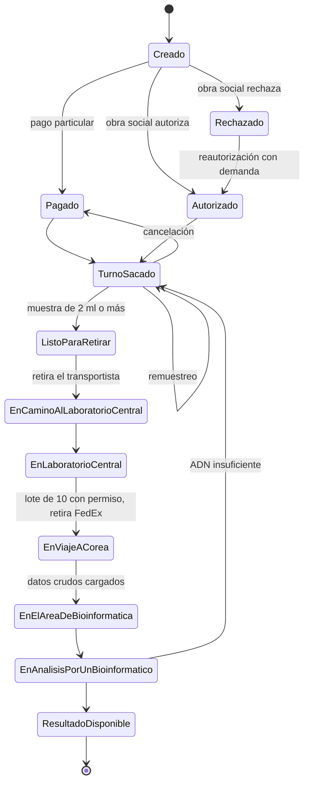

# GenLab

Plataforma web para un laboratorio de genética que realiza **estudios de exoma clínico** para pacientes con sospecha de patologías lisosomales (enfermedad de Fabry, enfermedad de Pompe, mucopolisacaridosis tipo 1, enfermedad de Gaucher y ASMD). Incluye además un **chatbot para el paciente**, publicado como servicio independiente para que lo consuman otros grupos (módulo adicional 8).

Proyecto grupal de la materia Taller de Tecnologías de Producción de Software, Opción E (UNLP). El coloquio es el **7 de diciembre de 2026**.

> **Estado:** esqueleto. Hay estructura, configuración, contratos y pantallas vacías, y todavía no hay lógica de negocio. El trabajo pendiente está en los [issues](../../issues) y se organiza por [milestones semanales](../../milestones).

## Qué hace el sistema

Un estudio recorre estos estados, en este orden:



Pompe urgente (paciente menor de 4 meses) no es un estado: es una marca de prioridad que adelanta el cierre del lote.

**Roles:** administrador general, gerente médico, médico tratante, paciente, administrativo del laboratorio, transportista y bioinformático.

## Stack

| Parte | Tecnología |
|---|---|
| Frontend | React, Vite, TypeScript, Tailwind, react-router, TanStack Query |
| Backend | FastAPI (Python 3.12), SQLAlchemy 2, Alembic, PostgreSQL |
| Chatbot | FastAPI separado, con la API de Anthropic |
| Local | docker-compose con Postgres y los tres servicios |
| Calidad | ruff y pytest (backend y chatbot), eslint, prettier y vitest (frontend) |
| CI | GitHub Actions: lint y tests en cada PR |

## Empezar

**Requisitos:** Docker con Docker Compose, Git y, si querés usar los atajos, `make`. Para correr cosas fuera de Docker: Python 3.12 y Node 24.

```bash
git clone https://github.com/SantiagoC1/GenLab_UNLP.git
cd GenLab_UNLP
cp .env.example .env
make up
```

| Servicio | URL |
|---|---|
| Frontend | http://localhost:5173 |
| Backend (documentación de la API) | http://localhost:8000/docs |
| Chatbot (documentación de la API) | http://localhost:8001/docs |

Comandos útiles:

| Comando | Qué hace |
|---|---|
| `make up` / `make down` | Levanta o baja todos los servicios |
| `make test` | Corre los tests de backend, chatbot y frontend |
| `make lint` | Corre ruff, eslint y prettier |
| `make migrate` | Aplica las migraciones de la base |
| `make seed` | Carga los datos de ejemplo |

**En Windows** `make` no viene instalado. Instalalo con `winget install GnuWin32.Make`, usá WSL, o corré directamente los comandos de `docker compose` que figuran dentro del `Makefile`.

Antes de la primera ejecución, completá en `.env` lo que necesites. Las claves (por ejemplo la de Anthropic para el chatbot) nunca se suben al repositorio.

## Estructura del repositorio

```
frontend/                React. Una carpeta por rol en src/roles/
  src/roles/pantallas.ts     lista de pantallas por rol (el menú y las rutas salen de acá)
backend/
  app/core/                  configuración, seguridad, base de datos, errores y enums
  app/modules/               un paquete por área (ver la tabla de abajo)
  app/integrations/          un adaptador por módulo externo, con su simulador
  alembic/                   migraciones
  tests/
chatbot/                 servicio independiente, con su Dockerfile y sus tests
docs/                    especificación, reparto de tareas y escenarios
tools/                   issues.json y crear_issues.py
.github/                 CI, plantilla de PR y plantillas de issue
```

| Paquete de `modules/` | Cubre | Escenarios |
|---|---|---|
| `acceso` | Registro, alta, activación e ingreso | 1 a 4 |
| `config_medica` | Patologías lisosomales y síntomas | 5, 6 |
| `consulta_medica` | Pacientes y estudios | 7 a 10 |
| `presupuesto_pago` | Presupuesto, cobertura, pago y autorizaciones | 11 a 14, 18, 19 |
| `cupones` | Cupones de descuento | 15 a 17 |
| `turnos` | Turno, documentos, inasistencias, muestra y remuestreo | 20 a 25 |
| `logistica` | Orden del día, lotes, permiso y FedEx | 26 a 33 |
| `bioinformatica` | Datos crudos, análisis y resultados | 34 a 39 |
| `avisos` | Avisos dentro de la plataforma | 41 |

## Integraciones externas

Hay módulos que construyen otros grupos: Familiograma, SNOMED, Cupones, CDSS, Apigen, Obras sociales, Avisos, Optimización de recorrido y FedEx. A eso se suma la API del Ministerio de Salud. Cada uno tiene una interfaz y un simulador en `backend/app/integrations/`, así que se puede desarrollar sin depender de nadie.

La variable `INTEGRACION_<NOMBRE>` elige `simulador` (por defecto) o `real`. Los contratos reales todavía no están cerrados: los métodos salen de la tabla de contratos mínimos de la especificación (módulo M10) y el cliente `real` tiene un TODO hasta acordar el formato con cada grupo.

## Chatbot

Servicio independiente, pensado para que otros grupos lo consuman.

```bash
curl -X POST http://localhost:8001/chat \
  -H "Content-Type: application/json" \
  -d '{"mensaje": "¿Qué es un exoma clínico?", "conversacion_id": null}'
```

Devuelve `{ "respuesta": "...", "conversacion_id": "..." }`. Por ahora responde un texto fijo. Con `CHATBOT_DISPONIBLE=false`, tanto `/health` como `/chat` responden 503 con un mensaje claro.

## Cómo trabajamos

- Las tareas están en los issues, numeradas como `[3.3]` o `[CB2]`. Cada una tiene sus criterios de aceptación.
- Ramas `feature/<id-tarea>-descripcion` creadas desde `develop`.
- Todo cambio entra por pull request, con al menos una revisión. Nadie hace push directo a `main` ni a `develop`.
- Usamos el vocabulario del glosario LEL en pantallas, mails y documentos.

Los detalles están en [`CONTRIBUTING.md`](CONTRIBUTING.md).

## Documentación

- [Especificación de requerimientos](docs/Especificacion_requerimientos_GenLab.md): alcance, módulos y requerimientos.
- [Reparto de tareas](docs/Reparto_de_tareas_GenLab.md): quién hace qué y en qué orden.
- [Escenarios de Leite](docs/Escenarios_laboratorio_genetica_v3.md): los 41 escenarios del dominio.

## Decisiones tomadas para el esqueleto

<details>
<summary>Ver las decisiones</summary>

Donde la consigna era ambigua, se eligió la opción más simple:

- **Pantallas del frontend.** La especificación no incluye una lista de pantallas. Se derivaron de los módulos M1 a M11 y de los 41 escenarios, y cada pantalla indica su escenario y sus requerimientos. Si cambia el reparto, se edita `frontend/src/roles/pantallas.ts` y el archivo de la pantalla.
- **Pantallas públicas.** Registrarse e Ingresar no pertenecen a un rol y viven en `src/roles/publico/`.
- **Avisos.** Es una sola pantalla (`/avisos`) y aparece en el menú de todos los roles.
- **Rol de desarrollo.** Hasta que exista el ingreso real (tarea 1.4), el rol sale de un selector visible solo en modo dev y se guarda en `localStorage`.
- **Tests de humo.** Cada paquete de `modules/` expone `GET /<modulo>/ping` solo para probar que el router está registrado. Se borra cuando el paquete tenga endpoints reales.
- **Estados.** `EstadoEstudio` usa valores sin espacios (`TurnoSacado`, `EnViajeACorea`). Pompe urgente es un booleano aparte.
- **Chatbot.** `CHATBOT_DISPONIBLE=false` lo apaga. Más adelante `/health` también debería reflejar si el modelo de lenguaje responde.
- **Ruff.** Se desactivó la regla E501 (largo de línea). El formateador se ocupa del código.
- **Hash y sesiones.** `core/security.py` solo declara el contrato (`requiere_rol`). Lo implementa la tarea 1.4.

</details>

## Equipo

| Integrante | Foco |
|---|---|
| Integrante A | Núcleo, acceso, consulta médica y contenido del chatbot |
| Integrante B | Presupuesto, pago, cupones, turnos y servicio del chatbot |
| Integrante C | Logística, bioinformática, avisos e interfaz del chatbot |