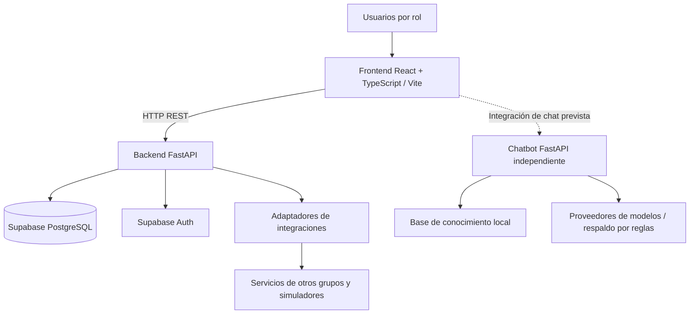
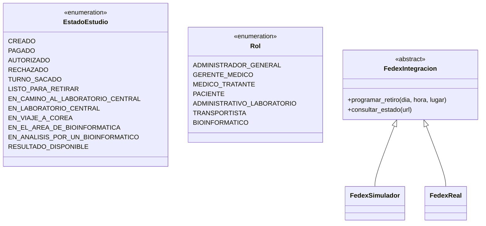
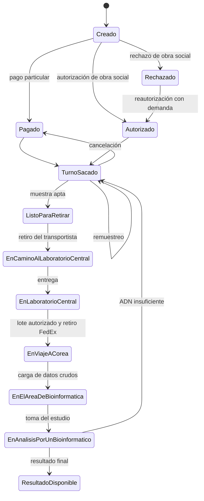

# T6 — Arquitectura y diseño de GenLab

**Responsable:** Integrante C
**Base:** repositorio `GenLab_UNLP.zip` recibido y documentación funcional del proyecto.
**Criterio:** diferenciar implementación comprobada de diseño funcional pendiente. Este documento no modifica código.

## 1. Alcance y fuentes

GenLab gestiona estudios de exoma clínico para pacientes con sospecha de patologías lisosomales. La transcripción corregida de la entrevista es la fuente principal de reglas de dominio; el glosario LEL, los escenarios y la especificación de requerimientos organizan dichas reglas. Para la arquitectura **implementada**, prevalece el código incluido en el ZIP. Los contratos externos pendientes no se presentan como cerrados.

## 2. Arquitectura física y lógica

La separación del frontend, backend y chatbot consta en `docker-compose.yml`. La base de datos y autenticación son servicios de Supabase externos al Compose local. La conexión exacta de la interfaz de chat al servicio se debe verificar al implementar CB5 y 9.2.

### 2.1 Frontend

- `frontend/src/App.tsx`: enrutamiento y protección de pantallas.
- `frontend/src/roles/`: pantallas separadas por rol; `pantallas.ts` registra rutas.
- `frontend/src/components/`: componentes compartidos y layout.
- `frontend/src/lib/`: acceso a API, sesión y validaciones.

Las pantallas presentes no implican que todos sus flujos estén conectados al backend.

### 2.2 Backend

- `backend/app/main.py`: crea la aplicación FastAPI, registra CORS, manejo de errores y routers.
- `backend/app/core/`: configuración, enumeraciones, seguridad y errores.
- `backend/app/models/`: acceso a datos de usuario, especialidades y dispositivos confiables.
- `backend/app/modules/`: acceso, configuración médica, consulta médica, presupuesto/pago, cupones, turnos, logística, bioinformática y avisos.
- `backend/app/integrations/`: adaptadores de servicios externos.
- `backend/app/database.py`: conexión a Supabase.
- `supabase/schema.sql`: definición de tablas, relaciones y restricciones.

### 2.3 Chatbot

- `chatbot/app/main.py`: servicio FastAPI y esquemas de consulta/respuesta.
- `chatbot/app/knowledge.py` y `chatbot/knowledge/`: recuperación y contenido temático.
- `chatbot/app/scope.py`: control de alcance.
- `chatbot/app/providers.py`, `llm.py`, `prompt.py`: integración con modelos.
- `chatbot/app/conversations.py`, `cache.py`, `ratelimit.py`: conversación, caché y límites.
- `docs/Contrato_API_Chatbot.md`: contrato documentado; comprobar compatibilidad con el servicio antes de integrar.

## 3. Diseño de clases y componentes comprobados

El backend no implementa todas las entidades como clases ORM: varias operaciones usan el cliente Supabase y diccionarios. Por eso se distingue el **diagrama de clases de código** del **modelo de datos SQL**.

Este diagrama es **parcial e ilustrativo**: contiene clases y enumeraciones verificadas. El modelo de datos completo debe representarse mediante un DER obtenido de `supabase/schema.sql`, sin inventar clases Python equivalentes a cada tabla. Los componentes de presupuesto incluyen `PresupuestoServicio` y `RepositorioEstudios`, con inyección de dependencias en el router.

## 4. Estados del estudio

Los valores de `EstadoEstudio` se encuentran en `backend/app/core/enums.py`. El siguiente flujo se documenta en el README del repositorio; es el **diseño de transiciones**, no evidencia de que todas estén implementadas.

**Nota:** el diagrama usa etiquetas abreviadas para mejorar su legibilidad. Los valores técnicos son los de `EstadoEstudio`. `Pompe urgente` es una **marca de prioridad independiente**, no otro estado; permite cerrar un lote anticipadamente. Los estados de lote, turno, cupón y autorización son dimensiones distintas y no deben confundirse con el estado del estudio. Antes de cambiar cualquier estado o transición se requiere coordinación con el integrante A, responsable del modelo base.

## 5. Integraciones

| Módulo / servicio | Responsabilidad en GenLab | Responsable del acuerdo | Estado observado |
|---|---|---|---|
| Familiograma (MA1) | Consumir PDF generado a partir de familiares | A | Adaptador presente; verificar contrato real |
| SNOMED (MA2) | Consultar términos médicos | A | Adaptador presente; verificar contrato real |
| Cupones (MA3) | Obtener, validar y marcar uso | B | Adaptador presente; verificar contrato real |
| CDSS (MA4) | Consultar correspondencia de síntomas y patología | A | Adaptador presente; verificar contrato real |
| Apigen (MA5) | Consultar genes, variantes y diagnóstico | A; C lo consume en bioinformática | Adaptador presente; verificar contrato real |
| Obras sociales (MA6) | Consultar cobertura y autorizaciones | B | Adaptador presente; verificar contrato real |
| Avisos (MA7) | Envío por canales externos | C | Adaptador presente; módulo interno solo ping |
| Chatbot (MA8) | Servicio propio para consultas de pacientes y terceros | A contrato; B servicio; C interfaz y despliegue | Servicio FastAPI implementado; integración UI pendiente de verificar |
| Optimización de recorrido (MA9) | Ordenar paradas del transportista | C | Adaptador presente; módulo logística solo ping |
| FedEx (MA10) | Programar retiro y consultar estado | C | Simulador presente; cliente real sin implementar |
| Ministerio de Salud | Simular permiso de salida | C | Adaptador presente; verificar lógica y contrato |
| Laboratorio de extracción / Telegram | Notificación de muestra | B | Verificar implementación del simulador |
| Pago simulado | Registro del pago particular | B | Verificar implementación |

El código `backend/app/integrations/fedex.py` define `FedexIntegracion`, `FedexSimulador` y `FedexReal`. El cliente real lanza `NotImplementedError`, por lo que no debe describirse como integración operativa. La especificación mantiene abierta la decisión sobre si FedEx notifica el retiro o GenLab consulta su estado.

## 6. Estado de implementación de los módulos relevantes para C

| Área | Evidencia del ZIP | Interpretación |
|---|---|---|
| Logística | `backend/app/modules/logistica/router.py` con `/ping` | Estructura creada; endpoints de negocio pendientes |
| Bioinformática | `backend/app/modules/bioinformatica/router.py` con `/ping` | Estructura creada; endpoints de negocio pendientes |
| Avisos | `backend/app/modules/avisos/router.py` con `/ping` | Estructura creada; endpoints de negocio pendientes |
| Frontend por rol | Pantallas en `frontend/src/roles/` | Componentes existentes; verificar funcionalidad individual |
| Chatbot | Servicio y pruebas en `chatbot/` | Implementación parcial/avanzada; verificar ejecución y contrato |
| Presupuesto | Router, servicio, repositorio, schemas y tests | Endpoints de negocio presentes |

## 7. Dependencias y coordinación

- **Integrante A:** arquitectura base, modelos y catálogo de estados; cualquier cambio estructural o de transición debe acordarse con A.
- **Integrante B:** pago/autorización, turnos y notificación de muestra lista para retirar; estos eventos habilitan la logística de C.
- **Integrante C:** logística, bioinformática, avisos y cliente de los servicios de optimización, FedEx y avisos; interfaz, pruebas y despliegue del chatbot.
- **Chatbot:** A define contenido y contrato, B implementa el servicio y C desarrolla su interfaz e integración, pruebas y despliegue.

## 8. Pendientes de verificación antes de cerrar T6

1. Contrastar el DER de `supabase/schema.sql` con los modelos utilizados en código, y documentar las relaciones principales sin inventar clases.
2. Verificar las rutas y contratos definitivos de integraciones externas, especialmente MA7, MA9, MA10 y Apigen.
3. Confirmar con A las transiciones del modelo de estados, especialmente cancelación, remuestreo y reanálisis.
4. Ejecutar pruebas para distinguir rutas funcionales de simples pantallas o routers de prueba.
5. Actualizar este documento a medida que se implementen las tareas 7.x, 8.x, 9.x y CB5–CB7.

**Conclusión:** la base técnica está organizada, pero las áreas de logística, bioinformática y avisos aún no tienen endpoints de negocio en el ZIP analizado. Esta documentación describe el estado inicial y sirve como registro actualizable durante el desarrollo, no como certificación de funcionalidades terminadas.
